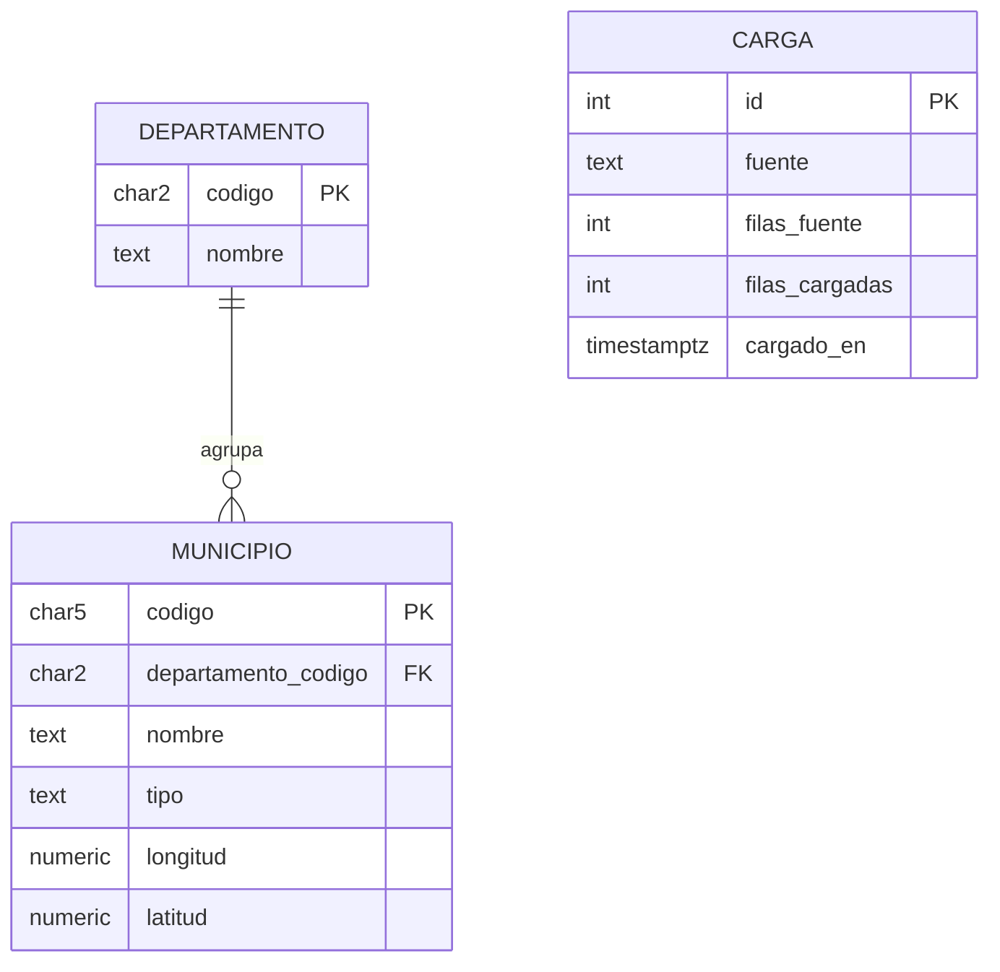

# Modelo de entidades

Dataset de trabajo mientras se publica el enunciado (decisión D1): **DIVIPOLA, códigos de
municipios**, datos.gov.co, recurso `gdxc-w37w`. Columnas de la fuente (verificadas el
26-sep-2026 sobre la descarga CSV, 1.122 filas):

`Código Departamento`, `Nombre Departamento`, `Código Municipio`, `Nombre Municipio`,
`Tipo: Municipio / Isla / Área no municipalizada`, `longitud`, `Latitud`
(las coordenadas vienen con coma decimal).

- `departamento` se deriva de las filas distintas de código y nombre de departamento.
- `municipio.tipo` admite los valores que traiga la fuente; se valida que no venga vacío.
- `carga` registra cada ejecución del cargador: es la evidencia de "creación y carga de los
  datos" que pide la rúbrica, consultable desde la app (`/api/resumen`).
